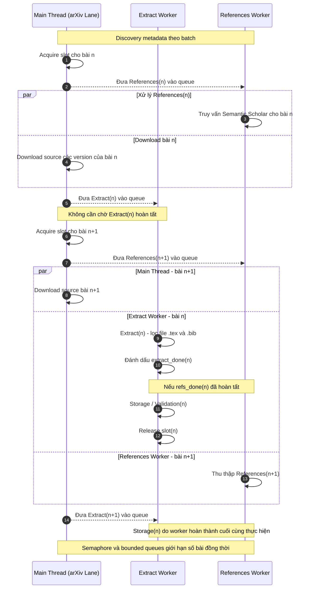

# 2. Pipeline
## 2.1. Tổng quan
Trong quá trình thu thập dữ liệu từ arXiv, hệ thống phải đi qua nhiều công đoạn liên tiếp bao gồm: khám phá metadata (discovery), tải mã nguồn bài báo (download), giải nén và trích xuất các tệp cần thiết (extract), thu thập thông tin tài liệu tham khảo (reference), và lưu trữ kết quả (storage). Nếu thực hiện tuần tự, công đoạn hiện tại phải hoàn thành trước khi di chuyển sang công đoạn tiếp theo. Để tiết kiệm thời gian xử lý và tận dụng tài nguyên, pipeline được thiết kế cho phép các công đoạn khác nhau hoạt động chồng lấp.

## 2.2 Kiến trúc
Pipeline gồm các công đoạn sau: 
- Discovery: Tiếp nhận danh sách arXiv ID, truy xuất metadata và xác định các phiên bản của từng bài báo.

- Download: Tải gói mã nguồn tương ứng với các phiên bản cần thu thập.

- Extract: Giải nén gói mã nguồn và giữ lại các tệp .tex, .bib theo yêu cầu.

- References: Truy vấn Semantic Scholar API để thu thập danh sách tài liệu được bài báo tham chiếu.

- Storage: Tổng hợp trạng thái xử lý và lưu kết quả xuống hệ thống tệp.

Mô tả kiến trúc xử lý như sau:

Sau khi Discovery cung cấp metadata của bài báo thứ n, hệ thống thực hiện các bước sau:

1. Luồng chính tạo một PaperJob để theo dõi trạng thái xử lý bài báo n.

2. Tác vụ References được đưa vào references_queue. References Worker có thể bắt đầu truy vấn Semantic Scholar.

3. Luồng chính tải tuần tự mã nguồn các phiên bản của bài báo n từ arXiv và ghi xuống ổ đĩa.

4. Khi Download kết thúc, tác vụ Extract của bài báo n được đưa vào extract_queue.

5. Extract Worker tiếp nhận tác vụ và bắt đầu giải nén, trích xuất mã nguồn.

6. Ngay sau khi bàn giao công việc Extract, luồng chính có thể chuyển sang Download bài báo n + 1, không cần chờ Extract của bài n hoàn thành.

7. Khi cả Extract và References của bài báo n đã kết thúc, worker hoàn thành sau cùng thực hiện Storage/Validation và giải phóng vị trí xử lý của bài báo đó.

Mặc dù các công đoạn được thực hiện gối đầu, pipeline vẫn phải đảm bảo dữ liệu của mỗi bài báo được kiểm tra đầy đủ trước khi đánh dấu hoàn tất.

Mỗi PaperJob có hai trạng thái quan trọng:

- extract_done: Cho biết nhánh Extract đã kết thúc.

- refs_done: Cho biết nhánh References đã kết thúc.

Sau khi một worker hoàn thành công việc, hệ thống cập nhật trạng thái tương ứng. Chỉ khi cả hai trạng thái đều được đánh dấu hoàn tất, Storage/Validation mới được kích hoạt.

Việc cho phép các giai đoạn xử lý chồng lấn lên nhau có thể khiến số lượng tác vụ tăng nhanh nếu không có cơ chế kiểm soát. Do đó hệ thống đặt giới hạn số bài xử lý tại một thời điểm bằng threading.BoundedSemaphore thông qua tham số pipeline_max_inflight và đặt hàng đợi có giới hạn cho 2 tác vụ extract và references.

Bên cạnh việc gối đầu các giai đoạn, pipeline còn hỗ trợ cơ chế prefetch giữa các batch discovery. Khi số lượng ID còn lại trong batch giảm đến ngưỡng pipeline_prefetch_remaining, luồng chính có thể bắt đầu truy vấn trước metadata của batch tiếp theo để tránh gián đoạn các stage sau. Cơ chế này không sử dụng một luồng Discovery riêng. Discovery và Download vẫn chia sẻ cùng một arXiv Lane, do đó các request đến arXiv tiếp tục được thực hiện tuần tự và tuân theo cơ chế điều tiết tốc độ.

Bảng dưới đây trình bày các tham số trong cấu hình mẫu của Bounded Pipeline.

| Tham số | Giá trị mẫu | Ý nghĩa |
|---|---:|---|
| `discovery_batch_size` | 20 | Số arXiv ID trong một batch Discovery |
| `pipeline_max_inflight` | 4 | Số bài báo tối đa đang xử lý nhưng chưa hoàn tất |
| `pipeline_extract_queue` | 2 | Kích thước tối đa của hàng đợi Extract |
| `pipeline_references_queue` | 4 | Kích thước tối đa của hàng đợi References |
| `pipeline_prefetch_remaining` | 5 | Ngưỡng số ID còn lại để chuẩn bị metadata cho batch kế tiếp |
